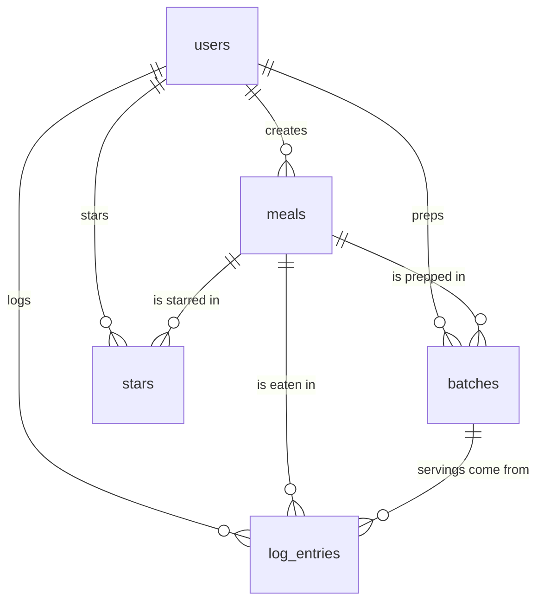

# Prepped: Plan

## 1. Pitch

I'm building **Prepped**, a meal-prep calorie tracker, because I batch-cook most of what I eat and I track calories, but calorie apps are built around logging single foods from a huge database. I want something built around the handful of meals I actually prep: log a serving in one tap, see calories and protein for the day against my goal, and know how many prepped servings are left in the fridge.

**How often:** every day, 3–4 times a day (each meal), plus a Sunday prep session each week.

## 2. Features

Numbered in the order I'll build them. Each one is its own Issue, branch, and pull request.

**Spine**

1. **Sign up and login.** As a new visitor, I want to create an account with my email and a password, then log in and log out, so that my meals and logs are private to me.
2. **Data model.** As a user, I want my meals, logs, and stars saved in a database and tied to my account, so that they're still there next time and nobody else can see them.
3. **Meals: create / read / update / delete.** As a user, I want to add a meal with a name, meal slot (breakfast, lunch, dinner, snack), calories per serving, protein per serving, and notes; see my list of meals; open a meal's detail page; edit it; and delete it after an "Are you sure?" confirmation, so that my meal library stays accurate.
4. **Daily log.** As a user, I want to log servings of a meal to a date (default today), see today's entries with a calorie and protein total, and remove an entry I logged by mistake, so that I know what I've eaten today.
5. **Validation.** As a user, if I leave the meal name or calories blank, or enter zero or negative calories or servings, I want a friendly message next to the field, so that I don't save bad data that throws off my totals.
6. **Stars.** As a user, I want to star my go-to meals and see them in a "Starred" view, so that I can log my regulars faster.
7. **Find things.** As a user, I want to search meals by name, filter by meal slot, and sort by newest, most calories, most protein, or most logged, so that I can find a meal quickly as my list grows.
8. **Dashboard.** As a user, I want a bar chart of calories per day for the last 14 days with my goal marked, plus summary stats (average daily calories, average daily protein, days I hit my goal, most-logged meal), so that I can see my trends at a glance.

**My 3 features**

9. **Daily goal + progress bar.** As a user, I want to set a daily calorie goal and see a progress bar on today's log (e.g. "1,450 / 2,200"), so that I know how much I have left at a glance.
10. **Meal-prep batches.** As a user, I want to record a prep batch ("Sunday: chicken & rice, 5 servings") and have servings left count down as I log from it, so that I know what's still in the fridge.
11. **Logging streak.** As a user, I want to see how many days in a row I've logged at least one meal, so that I'm motivated to keep logging.

## 3. Database

All data is scoped to a user. Types use: text, number, date, true/false.

| Table | Columns (type) | Primary key | Connects to |
|---|---|---|---|
| **users** | id (text), name (text), email (text, unique), email_verified (true/false), daily_calorie_goal (number, default 2200), created_at (date) | id | has many meals, log_entries, batches, stars |
| **meals** | id (number), user_id (text), name (text), slot (text: breakfast / lunch / dinner / snack), calories (number, per serving), protein_g (number, per serving), notes (text), created_at (date) | id | belongs to a user; has many log_entries and batches |
| **log_entries** | id (number), user_id (text), meal_id (number), batch_id (number, optional), eaten_on (date), servings (number, default 1), created_at (date) | id | belongs to a user, a meal, and optionally a batch |
| **batches** | id (number), user_id (text), meal_id (number), servings_made (number), prepped_on (date), created_at (date) | id | belongs to a user and a meal; has many log_entries |
| **stars** | user_id (text), meal_id (number), created_at (date) | (user_id, meal_id) together | junction table: "this user starred this meal" |

- **One-to-many:** a user has many meals; a meal has many log entries; a meal has many batches; a batch has many log entries.
- **Many-to-many:** users ↔ meals through **stars**. One stars table for everyone.
- **Calculated, not stored:** calories for an entry = meal calories × servings. Servings left in a batch = servings_made − servings logged from it.
- The login library also keeps its own bookkeeping tables (sessions, accounts, verification). They're listed in schema.md but aren't part of my design.

## 4. Tests

1. **Data isolation.** Given User A has a meal "Chicken & rice" and User B is a brand-new account, when User B loads their meal list and tries to open User A's meal by its id, then User B's list is empty and the meal page says "not found".
2. **Dashboard stat.** Given I logged 2,000 calories on Monday and 2,400 on Tuesday (including one entry of 1.5 servings) and nothing on Wednesday, when the dashboard calculates average daily calories, then it shows 2,200, because it averages only the days I logged.

## 5. Technologies

| Choice | What | Why |
|---|---|---|
| Coding agent | Claude Code (desktop app) | Builds each feature on its own branch and opens the PRs, so the whole loop runs in one place. |
| App framework | Next.js (TypeScript) | Same framework as my Assignment 1, and it deploys to Vercel with no setup. |
| Database | Neon (hosted Postgres) | Free, real Postgres that I've already used. |
| Database code | Drizzle | Tables are defined in code, so schema.md can be checked against the real thing. |
| Sign up and login | Better Auth, email + password | Accounts are stored as rows in my own users table (a spine requirement), and login uses a secure cookie. |
| Hosting | Vercel | Redeploys automatically on every merge to main, so the live URL stays current. |
| Libraries | Tailwind CSS, Recharts, Zod, Vitest | Styling, the dashboard chart, form validation with friendly messages, and the two tests. |

## 6. Design

- **Feel:** clean, calm, and fast. Mobile-first, since I'll log meals on my phone.
- **Colors:** off-white background, dark slate text, one fresh green accent for "on target" and buttons, amber when I'm over my goal.
- **Style:** rounded cards, big bold numbers for daily totals, no clutter. Starring is a single tap.
- **Inspiration:** MacroFactor (simple daily totals against a target) and Apple Health (big stat cards and plain bar charts).

## 7. Risks and cuts

- **Least sure I can build:** meal-prep batches. Servings left has to stay right when I edit or delete a log entry, and the app has to know which batch a serving came from.
- **Cut first:** the logging streak. If batches get shaky, I'll ship them with a "servings left" number I adjust by hand instead of an automatic countdown.
- **Time risk:** everything is due Wednesday Nov 4, so the app has to be live by Tuesday evening to leave room for the stranger test and the fix PR.

---

## Plan vs. Reality

_Added at the end, after the build. Everything above this line is the original plan, unchanged since it merged in PR #2._

| Planned feature | Shipped / Changed / Cut | Status | Learning | What changed and why (one line) |
|---|---|---|---|---|
| 1. Sign up and login | Shipped | Done | "Accounts in my own users table" ruled out hosted login services | As planned. The agent added an 8-character password minimum and server-action forms (PR #6). |
| 2. Data model | Changed | Done | A schema can arrive one migration per feature instead of all at once | `batches` and `users.daily_calorie_goal` were built with Features 10 and 9, not up front, and the agent added database CHECK rules (PR #8). |
| 3. Meals CRUD | Shipped | Done | "Are you sure?" can be a styled dialog, not the browser's popup | As planned. The agent chose a custom confirm dialog that also warns the meal's log history goes too (PR #10). |
| 4. Daily log | Changed | Done | Servers run on UTC, so "today" has to come from the user's browser | Added time-zone handling (Vercel's clock would flip the day at ~4pm Pacific), day-by-day navigation, and per-meal history (PR #14). |
| 5. Validation | Shipped | Done | Validate on the server; the browser's checks can be skipped | As planned, plus typo guards (≤ 10,000 cal, ≤ 20 servings) the agent added. Its first draft was convoluted and got rewritten (PR #16). |
| 6. Stars | Shipped | Done | One junction table with a (user, meal) primary key makes double-starring impossible | As planned. The star sits beside the meal link, not inside it (invalid HTML) (PR #18). |
| 7. Find things | Shipped | Done | Keeping filters in the URL makes refresh and back "just work" | As planned (4 sorts). A stale dev server caused a scary hydration error that wasn't a real bug (PR #20). |
| 8. Dashboard | Changed | Done | A vague phrase in a plan ("days I hit my goal") becomes a decision someone else makes | The agent defined "on goal" as at or under the goal and limited stats to the 14-day chart window. A streak tile was added later (PRs #22, #28). |
| 9. Daily goal + progress bar | Shipped | Done | — | As planned, with an editable goal (800–6,000) that the dashboard now uses too (PR #24). |
| 10. Meal-prep batches | Changed | Done | Calculating "servings left" instead of storing it removed the risk I was most worried about | Servings left is computed from the log, logging uses the oldest batch automatically, and a Fridge page was added that wasn't in the plan (PR #26). |
| 11. Logging streak | Shipped | Done | The "cut first" feature was small once the data existed | Not cut. The streak stays alive until the day ends, so it doesn't read 0 at breakfast (PR #28). |
| Tests (section 4) | Shipped | Done | Breaking the code on purpose proves the test can actually fail | Both tests as written, with red/green screenshots (PRs #12, #22), plus 47 extra checks. |
| Technologies (section 5) | Changed | Done | A "local copy" of the database can be its own source of bugs | Added PGlite as the local/test database (not planned). Force-stopping the dev server corrupted it three times, so it now auto-rebuilds (PRs #4, #20, #24). Next.js "Cache Components" turned off. |
| Time risk (section 7) | Changed | Done | Account steps (accepting terms, logins) are the real bottleneck, not code | The app was built by mid-afternoon, but going live waited about an hour on a Neon terms click only I could do. Live at prepped-beta.vercel.app on Tue Nov 3. |
| _(not planned)_ Food library | Added | Done | I designed for someone who already knows their meals. A new user starts with nothing | The stranger test showed a new account couldn't log anything until they invented a meal and knew its calories. Added a shared `foods` table with 129 common foods that you can adjust, revert and restore (PR #38). |
| _(not planned)_ Phone layout | Changed | Done | Measure the layout instead of eyeballing screenshots | On a 375px phone the Dashboard tab was hidden off the edge of the nav. Phones now get a 5-column nav (PR #36). |
| _(not planned)_ Targets questionnaire | Added | Done | A default number (2,200) only works for someone who already knows their goal | The stranger wanted the app to work out their goals. Added an optional post-sign-up questionnaire that sets calorie and protein targets, plus a protein goal the plan never had (PR #40). |
| _(not planned)_ Greeting + profile | Added | Done | Small personal touches make it feel like my app, not a database form | My own idea after using it: a time-of-day greeting with today's status, and a profile page linked from my name in the header (PR #42). |
