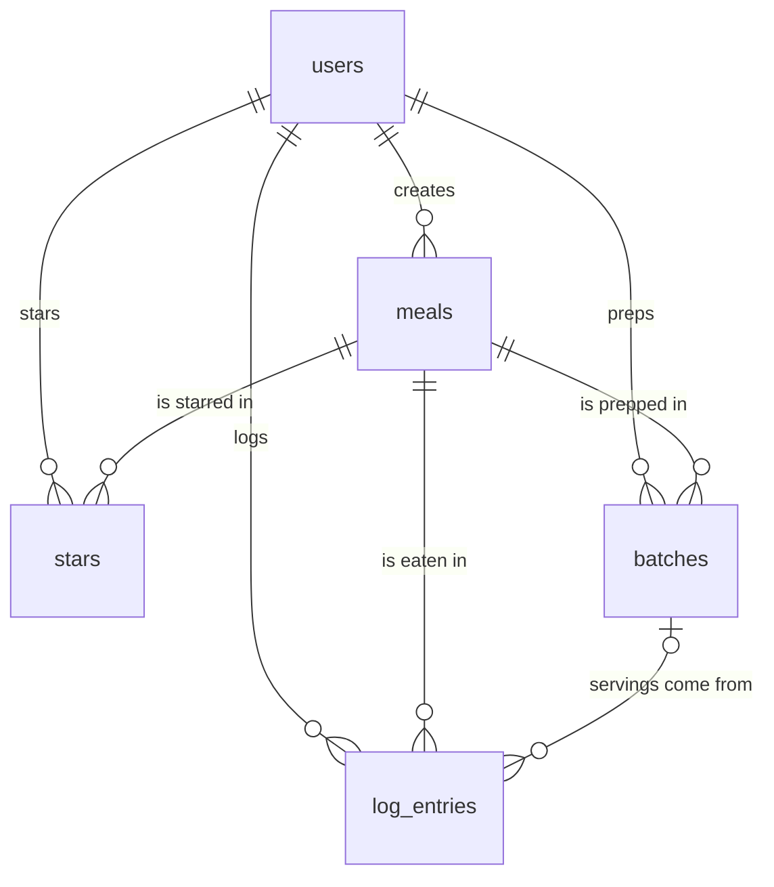

# Prepped: database schema

Postgres (Neon in production, PGlite locally). Tables are defined in [`src/db/schema.ts`](src/db/schema.ts), and the SQL that creates them is in [`drizzle/`](drizzle/).

## My tables

| Table | What one row means | Columns (type) | Primary key |
|---|---|---|---|
| **users** | One account | id (text), name (text), email (text, unique), email_verified (true/false), image (text, optional), daily_calorie_goal (number, default 2,200), created_at (date/time), updated_at (date/time) | id |
| **meals** | A meal I cook or eat repeatedly | id (number), user_id (text), name (text), slot (text: breakfast / lunch / dinner / snack), calories (number, per serving), protein_g (number, per serving), notes (text, optional), created_at, updated_at | id |
| **log_entries** | One time I ate a meal | id (number), user_id (text), meal_id (number), batch_id (number, optional), eaten_on (date), servings (number, default 1), created_at | id |
| **batches** | One meal-prep session | id (number), user_id (text), meal_id (number), servings_made (number), prepped_on (date), created_at | id |
| **stars** | "This user starred this meal" | user_id (text), meal_id (number), created_at | (user_id, meal_id) together |

## How they connect

- **users → meals: one-to-many.** Each meal belongs to one user (`meals.user_id`).
- **meals → log_entries: one-to-many.** Each log entry is a serving of one meal (`log_entries.meal_id`). Deleting a meal deletes its log entries.
- **users → log_entries: one-to-many.** Entries also carry `user_id`, so "today's log" can be read without going through meals.
- **meals → batches: one-to-many.** A meal can be prepped many times (`batches.meal_id`).
- **batches → log_entries: one-to-many.** A log entry can say which batch the serving came from (`log_entries.batch_id`, optional). **Servings left** is calculated (servings made − servings logged from the batch), never stored, so deleting a log entry automatically puts its servings back. Removing a batch keeps the log entries and just clears their `batch_id`.
- **users ↔ meals through stars: many-to-many.** `stars` is the junction table: one row per (user, meal) pair, one table for everyone. Starring twice is impossible, because the pair is the primary key.

## Rules the database enforces

These hold even if the app has a bug:

- A meal's name can't be blank. Calories must be more than 0, protein can't be negative, and the slot must be breakfast, lunch, dinner or snack.
- Servings in a log entry, and servings made in a batch, must be more than 0.
- Deleting a user deletes all their meals, log entries and stars. Deleting a meal deletes its log entries and stars.

## Login bookkeeping (Better Auth)

These tables exist so login works. I didn't design them.

| Table | Purpose |
|---|---|
| **sessions** | One row per logged-in browser (token, expiry, user_id) |
| **accounts** | Login method per user. For email + password, this holds the hashed password |
| **verifications** | Short-lived tokens (e.g. email verification) |

## Compared with PLAN.md section 3

| Planned | Built so far | Notes |
|---|---|---|
| users | ✅ | `daily_calorie_goal` added in Feature 9 (migration `0002_daily_goal.sql`) |
| meals | ✅ | As planned. `protein_g` defaults to 0 if left empty |
| log_entries | ✅ | `batch_id` added in Feature 10 (migration `0003_batches.sql`) |
| batches | ✅ | Added in Feature 10. As planned, plus a database check that servings made > 0 |
| stars | ✅ | As planned |
